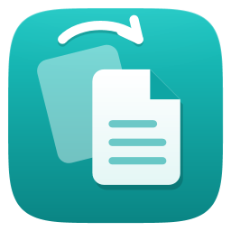

<p align="center"></p>

<h1 align="center">Flipr</h1>
<p align="center"><b>Drag. Flip. Done.</b><br>Convert, edit and manage files without opening an app. For Windows 10 (19041+) and 11.</p>

Flipr is a drag-and-drop file converter for Windows, in the spirit of Tangerine for Mac. Drag files, tap **Shift**, and let go on the format you want. The result appears next to the original, and the original is never changed.

Flipr is built on [OrbitDrop](https://github.com/i3sam/OrbitDrop) by Mohammed Essam (MIT). It adds document, PDF, spreadsheet, subtitle, media and archive conversions on top, plus its own identity in Flip Teal (`#0EA5A4`).

## How it works

1. **Drag a file, then tap Shift.** Start dragging one or more files in File Explorer or on the desktop and keep holding. Tap Shift once and the wheel opens around the pointer.
2. **Let go on what you want.** The result appears **next to the original**. Let go on the centre or press **Esc** to cancel.
3. **Tap Shift again for more.** Each tap switches between **Convert**, **Tools** and **Actions**. Slices with dots (like **More** or **Compress**) open into more choices when you rest on them.

**No dragging?** Select files, press **Ctrl + Alt + Space** and click an option. **Or right-click** files or folders in File Explorer and choose **Flipr**. Every result can be **undone** for a few seconds (it goes to the Recycle Bin).

**Make it yours.** Settings → **Wheel** shows every wheel: click a slice to hide it, drag a slice to move it, then **Save**.

## What it converts

| From | To | Needs |
|---|---|---|
| **Images** (PNG, JPG, WebP, JFIF, BMP, TIFF, GIF, SVG; HEIC, AVIF, JPEG XL, RAW with Windows codecs) | PNG, JPG, WebP, JFIF, BMP, TIFF, GIF, PDF | — |
| **PDF** | Word (DOCX), PowerPoint (PPTX, a slide per page), Excel (XLSX, tables rebuilt from the layout), TXT, Markdown, PNG, JPG | Word only for DOCX |
| **Word** (DOC, DOCX, RTF, ODT) | PDF, DOCX, TXT, Markdown, HTML, RTF, ODT | Microsoft Office or LibreOffice |
| **Markdown / TXT** | PDF, DOCX, HTML (and Markdown → TXT) | Office or LibreOffice for PDF and DOCX |
| **Spreadsheets** (XLS, XLSX, ODS, CSV, TSV) | PDF, XLSX, CSV, TSV, ODS | Office or LibreOffice |
| **Slides** (PPT, PPTX, ODP) | PDF, PPTX, PNG, JPG (an image per slide) | Office or LibreOffice |
| **Subtitles** (SRT, VTT) | SRT, VTT, TXT transcript | — |
| **Video** (MP4, MOV, MKV, WebM, AVI, WMV …) | MP4, WMV, GIF; extract MP3, M4A, WAV, WMA, FLAC · **More:** MKV, WebM, MOV, AVI, OGG, Opus, AIFF | FFmpeg for **More** |
| **Audio** (MP3, M4A, WAV, WMA, FLAC; OGG, Opus, AIFF …) | MP3, M4A, WAV, WMA, FLAC, OGG, Opus, AIFF | FFmpeg for OGG, Opus, AIFF and their inputs |
| **CorelDRAW** (CDR, CMX) | PDF, SVG, PNG, JPG, WebP, TIFF, BMP | — |

**Tools:** image edit (crop, adjust, markup, redact), compress, resize, rotate, grayscale, OCR · PDF merge, split, compress, rotate · video trim, compress, remove audio, snapshot, join · audio trim, compress, normalize, mono/stereo · extract ZIP, 7Z, RAR, TAR, TAR.GZ, TAR.XZ, TAR.BZ2, GZ, CAB, ISO · file info, edit details, remove metadata.

**Actions:** copy path or name, show in folder, copy/move to, float shelf, share, **archive as ZIP, 7Z or TAR.GZ**, terminal, set as wallpaper. These work on folders too.

### Optional helpers

- **FFmpeg** unlocks the extra media formats: `winget install Gyan.FFmpeg`. Flipr finds it automatically, even if you install it while Flipr is running.
- **LibreOffice** is used for documents when Microsoft Office isn't installed: `winget install TheDocumentFoundation.LibreOffice`.

**Private by design:** everything runs locally. There are no uploads, no account and no telemetry. Update checks stay off until Flipr has its own releases repository (`Brand.ReleasesRepo`).

## Build from source

Requirements: Windows 10/11 and the [.NET 10 SDK](https://dotnet.microsoft.com/download) (`winget install Microsoft.DotNet.SDK.10`). For the installer, add Inno Setup 6 (`winget install JRSoftware.InnoSetup`).

```powershell
dotnet build Flipr.slnx -c Release
dotnet test tests/Flipr.Tests
dotnet run --project src/Flipr.App          # runs from source (lives in the notification area)
./build/package.ps1                         # → artifacts/: setup.exe, portable.zip, SHA256SUMS.txt
dotnet run --project tools/IconGen          # regenerates the icon set in assets/brand
```

Tests that need Word, Excel, PowerPoint or FFmpeg skip themselves when those aren't installed.

## Brand

| | |
|---|---|
| Name | Flipr |
| Accent | Flip Teal `#0EA5A4` (fill in light and dark themes), ink on it `#011F1E` (5.7:1) |
| Teal text | `#0A7C7B` on light surfaces, `#2DD4CF` on dark |
| Icon | A file card flipping over another, on a teal tile (`tools/IconGen`, output in `assets/brand`) |
| Where it lives | Colours: `src/Flipr.UI/Themes/Tokens.*.xaml` · name, release repo: `src/Flipr.Infrastructure/Brand.cs` |

## Repository map

| Path | What |
|---|---|
| `src/Flipr.App` | Composition root, tray lifecycle, interaction controller |
| `src/Flipr.UI` | Design system, radial wheel, toasts, Settings, onboarding |
| `src/Flipr.Windows` | Win32/COM: drag detection, OLE drop target, tray, theme, shell |
| `src/Flipr.Core` | Operation contracts, registry, collision-safe atomic output |
| `src/Flipr.Conversion` | Converters: images, PDF (`Pdf/`), documents (`Documents/`), media (`Media/`, FFmpeg included), subtitles |
| `src/Flipr.Tools` | Tools and actions: image tools, archives, metadata, file actions |
| `src/Flipr.Jobs` / `Infrastructure` | Background jobs, settings, brand, local logs |
| `experiments/OrbitProbe` | Upstream feasibility probe, kept as a diagnostics tool |
| `docs/` | Research, architecture, design system |

## License

MIT. See [LICENSE](LICENSE) and [THIRD-PARTY-NOTICES.md](THIRD-PARTY-NOTICES.md). Flipr includes OrbitDrop's code under its MIT licence. It shares no code, artwork or branding with Tangerine.
